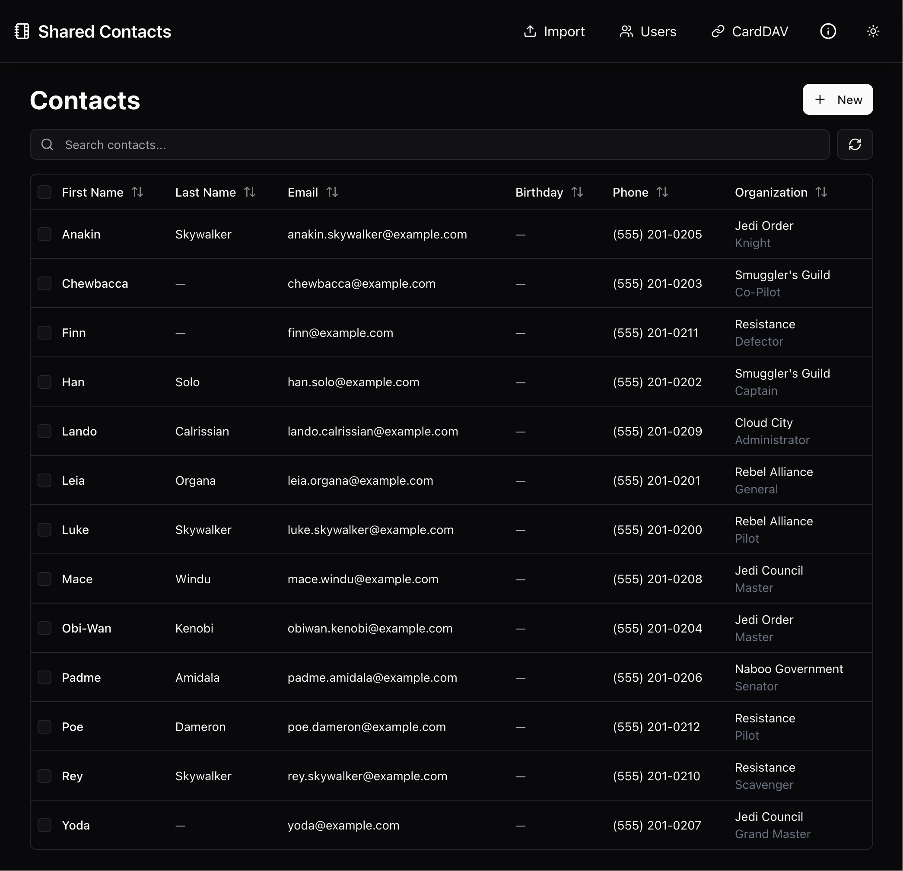
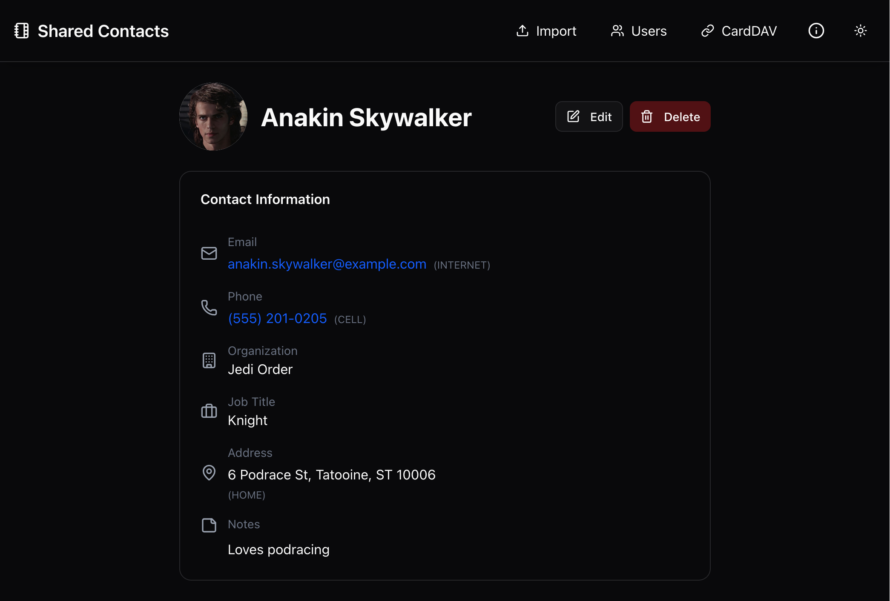
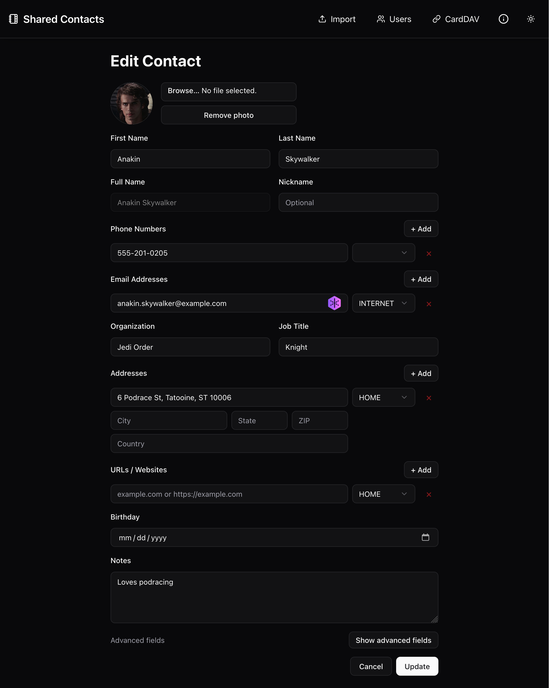
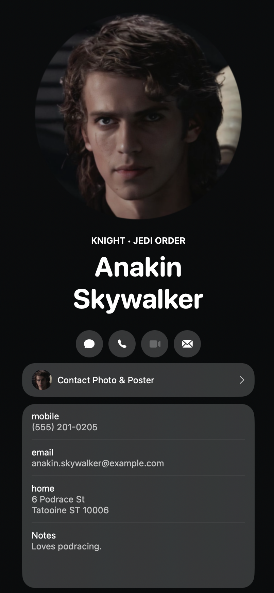

# Shared Contacts - CardDAV Server

[](https://www.gnu.org/licenses/agpl-3.0)

> [!WARNING]
> This project is not production ready but is slowly becoming more stable. I stood this project up as an experiment with Cursor and I'm now trying to harden it. Do NOT use this without proper backups or with mission-critical data.
>
> Security model: the CardDAV server (Radicale) authenticates with per-user htpasswd/bcrypt credentials. The management UI and its internal admin API have NO built-in login of their own, so they must only be reachable on a trusted network. Do not expose the UI or the admin API publicly; put them behind a reverse proxy with access control (or a VPN) and keep CardDAV behind HTTPS.

> [!NOTE]
> To avoid exposing anything, one might run this locally and access it through a VPN (e.g. Tailscale).

A self-hostable CardDAV server for managing shared contacts with a modern web-based management interface.

## Why?

I've been waiting for Apple to create a shared address book feature for iCloud for ages and I finally decided to make a personal one for myself. I rely on my contacts for the usual things but also birthdays and notes. I didn't want a full-blown CRM but something more lightweight.

I also have a large extended family that I'd love to stay in touch with as much as possible. This allows me to simply create users (per person or basic read/rw users) and share the CardDAV URL. Now, we can update any details we need to, when we need to.

## Features

- **CardDAV Server**: Full CardDAV protocol support via Radicale
- **Web Management UI**: Modern React-based interface built with TanStack Start
- **PostgreSQL Backend**: Queryable database for fast contact searches
- **Bidirectional Sync**: Automatic synchronization between CardDAV and database
- **Contact Lists**: Lists (groups) made in Apple Contacts sync to everyone sharing the address book
- **User Management**: Manage Radicale users for CardDAV access
- **Scheduled Backups**: Timestamped archives written to disk on an interval, with retention
- **Docker Compose**: Easy deployment with Docker

## Screenshots






## AI Contribution Disclosure


> [!IMPORTANT]
> This project uses [Level 5 AI assistance](https://www.visidata.org/blog/2026/ai/) — AI generated the majority of the code, but the human was involved at every step, reviewing each line with full attention. The human understands every algorithm and has logically validated how it all works.
>
> **AI Model:** Claude Opus 4

## Quick start

You need Docker with the Compose plugin. Everything else runs in containers.

**1. Make a directory and fetch the compose file.**

```bash
mkdir shared-contacts && cd shared-contacts
curl -O https://raw.githubusercontent.com/shawnphoffman/shared-contacts/main/docker-compose.prod.yml
```

**2. Set the database credentials.** Compose refuses to start without them.

```bash
printf 'POSTGRES_USER=sharedcontacts\nPOSTGRES_PASSWORD=%s\nBACKUP_ENABLED=true\n' "$(openssl rand -hex 24)" > .env
```

`BACKUP_ENABLED` is off in the compose file so an upgrade never starts writing archives on someone unannounced, but a new install should have it on: it writes a daily archive to `./backups` and keeps the newest seven. See [docs/backups.md](docs/backups.md) to change the interval or retention.

> Keep the password to URL-safe characters if you pick your own. It is interpolated into a `postgresql://` connection string, so a `/`, `@`, `#` or `?` in it breaks the URL and the sync service fails to start with a parse error rather than anything that names the password.

**3. Publish the UI port.** The compose file ships with it commented out, because the UI and its admin API have no login of their own. Uncomment it only if the host is on a trusted network; otherwise leave it closed and put the app behind your reverse proxy (there are Traefik labels in the file to start from).

```bash
sed -i.bak "s|# ports:|ports:|; s|#   - '\${UI_PORT:-3030}:3030'|  - '\${UI_PORT:-3030}:3030'|" docker-compose.prod.yml
```

**4. Start it.**

```bash
docker compose -f docker-compose.prod.yml up -d
```

The first start creates the database, applies the migrations and brings up Radicale, the sync service and the UI inside one container. Watch it come up with `docker compose -f docker-compose.prod.yml logs -f`.

**5. Open the UI** at <http://localhost:3030>. The sidebar shows a sync status; it turns green once the sync service answers.

**6. Create your first CardDAV user.** Go to **Book Users** in the sidebar, then **Create User**. Passwords are at least 12 characters, and the username becomes part of the CardDAV URL, so keep it to letters, numbers, dot, underscore or hyphen.

> There is no command-line path for this. Radicale reads an htpasswd file, but the image ships no `htpasswd` binary, so the UI is how accounts are made.

**7. Connect a device.** The **CardDAV Config** page shows the URL and, on Apple platforms, offers a `.mobileconfig` profile. In iOS or macOS Settings, add a CardDAV account with that URL and the credentials from step 6.

Contacts added on a device sync to the database within `SYNC_INTERVAL` (30 seconds by default), and contacts added in the UI sync back out the same way.

## Upgrading

```bash
docker compose -f docker-compose.prod.yml pull
docker compose -f docker-compose.prod.yml up -d
```

Migrations run automatically at startup, and the service refuses to start rather than run with a schema it cannot account for, so check the logs if a container does not come back.

Take a backup first. The **Backups** page has a "Run backup now" button, or use the `pg_dump` recipe below.

To stay on a known release instead of following `latest`, set `APP_VERSION` in `.env`:

```bash
echo 'APP_VERSION=v1.12.0' >> .env
```

## Backup and Restore

### Scheduled backups (recommended)

The app writes timestamped `.tar.gz` archives to disk on a schedule and keeps the newest N. Each archive holds a full logical dump of every table (`snapshot.json`) plus `contacts.vcf` and `contacts.csv`. Manage them from the **Backups** page in the sidebar, or run one on demand there.

```bash
BACKUP_ENABLED=true
BACKUP_INTERVAL=12h
BACKUP_KEEP=14
```

See [docs/backups.md](docs/backups.md) for what is and isn't covered, where the files land, and how to restore.

### Backup the database by hand

Run from the directory holding `docker-compose.prod.yml`. The credentials are read inside the container from the environment Compose already gives it, so there is nothing to substitute.

```bash
docker compose -f docker-compose.prod.yml exec -T shared-contacts-postgres sh -c 'pg_dump --clean --if-exists -U "$POSTGRES_USER" sharedcontacts' > backup.sql
```

`--clean` matters: without it the dump only knows how to build a database from nothing, so restoring it over a database that already has tables fails on every statement and leaves the old data in place.

### Restore the database

> This overwrites the contacts currently in the database. Take a backup first.

```bash
docker compose -f docker-compose.prod.yml exec -T shared-contacts-postgres sh -c 'psql -v ON_ERROR_STOP=1 -U "$POSTGRES_USER" sharedcontacts' < backup.sql
```

`ON_ERROR_STOP=1` makes a failed restore stop and report a non-zero exit rather than skipping the statement it choked on and leaving you with a half-restored database that looks like it worked.

### Backup the Radicale data

The CardDAV collections and the `htpasswd` file live in the app container, in the volume mounted at `/data`. That file holds the CardDAV credentials and is not in the scheduled archives, so it is worth keeping a copy.

```bash
docker compose -f docker-compose.prod.yml exec -T shared-contacts-app tar czf - /data > radicale-data.tar.gz
```

> These use the production service names. In the development stack (`docker-compose.yml`) the services are `postgres` and `radicale`, and Radicale runs in its own container rather than inside the app.

## Security Notes

1. **Change default passwords** in production
2. **Use HTTPS** in production (configure reverse proxy)
3. **Restrict network access** to services
4. **Regular backups** of database and Radicale data
5. **Keep Docker images updated**

The container's services run as an unprivileged user (`PUID`/`PGID`, default `1000`), not as root. Set them to your host account so bind-mounted files belong to you: see [docs/permissions.md](docs/permissions.md).

### Security settings

All three default to the safe behaviour, so a stock deployment needs none of them.

| Variable                   | Service      | Default | What it does                                                                                                                                                                                                                                                                                                                                                          |
| -------------------------- | ------------ | ------- | --------------------------------------------------------------------------------------------------------------------------------------------------------------------------------------------------------------------------------------------------------------------------------------------------------------------------------------------------------------------- |
| `TRUST_PROXY_HEADERS`      | UI           | off     | Whether to believe `X-Forwarded-For` / `X-Real-IP` when recording who made a change. Off means `contact_history.client_ip` stays empty. Turn it on **only** when a reverse proxy you control overwrites those headers - the app has no login, so an untrusted value lets any caller stamp an address of its choosing on the audit trail.                              |
| `UI_ALLOWED_ORIGINS`       | UI           | empty   | Extra origins allowed to make state-changing requests, comma-separated (`https://contacts.example.com`). Every non-GET request is rejected unless its `Origin` matches the host it arrived on, which is what stops another site the browser has open from driving this one. Needed only when a proxy rewrites `Host` to something other than the address people type. |
| `SYNC_API_ALLOWED_ORIGINS` | sync-service | empty   | Origins allowed to call the internal sync API from a browser, comma-separated. Empty means no browser can: the API has no authentication and is only meant to be reached by the UI's server process over the internal network.                                                                                                                                        |

If you run the UI behind a reverse proxy (Traefik, Caddy, nginx, a Cloudflare tunnel), the usual setup is `TRUST_PROXY_HEADERS=true` and nothing else, since a proxy that forwards `Host` unchanged already satisfies the origin check.

## Timezone

The app container runs in UTC, pinned in the Dockerfile and in both compose files. Leave it that way.

Conflict resolution compares `contacts.updated_at` (written by a Postgres trigger, in the database session's zone) against vCard file mtimes, and `getContactsNeedingRadicaleSync` compares that same column against a watermark the app writes as a JS `Date`. Since `22_contacts_timestamptz.sql` those columns carry a time zone, so the two writers agree on an instant regardless of process zone. Before that migration they did not, and an app container on a non-UTC zone put the two an offset apart in the same row: the database copy won every conflict, so **no edit made in a CardDAV client ever survived** - it was reverted on the next sync.

If your deployment platform injects a `TZ` for containers, override it to `UTC` for this one.

## Contact lists (groups)

Apple Contacts lets you nest **lists** under an address book to group people. A list is not a server-side object: it is an ordinary vCard stored in the same collection, marked `X-ADDRESSBOOKSERVER-KIND:group`, naming its members by UID. vCard 4 clients use the unprefixed `KIND:group` / `MEMBER` spelling instead; both are accepted, and profiles are always written back in the Apple spelling that Contacts reads.

Lists are created **in your CardDAV client**. Make a list on your Mac or iPhone and it syncs to everyone subscribed to that address book, with the same people in it. Adding and removing members propagates the same way, and is only done in the client.

The **Lists** page in the web UI shows every list with its members and address books, and can **rename** or **delete** one. That exists because Apple Contacts does not always let you: a list it refuses to rename or remove stays on every device forever otherwise. A rename rewrites only the name on the stored card, leaving the member lines untouched; a delete removes the card from the master mirror and from every subscriber's collection on the next sync, and does not touch the people who were in it.

Elsewhere the web UI treats lists as read-only: a contact's detail page displays the lists it belongs to as dashed badges next to its address books, and group cards are hidden from the contact list, duplicate detection, CSV export, and trash, so they never show up as phantom contacts. A list deleted from the web UI does not land in the trash for the same reason; undo it from the History page instead.

> [!IMPORTANT]
> An address book is shared, so deleting a contact or a list on one device deletes it for **every** subscriber of that book. This is deliberate: the alternative is silent, permanent divergence between people's devices.

## Mobileconfig profiles and signing

You can generate `.mobileconfig` profiles from the CardDAV Connection page to simplify setting up iOS and macOS clients. Two download options are available per user:

- **Download profile** (per book): installs a single CardDAV account. Appears as its own entry in _Settings → General → VPN & Device Management_.
- **Download combined profile** (per user): bundles every address book the user can access into a single profile that installs as **one entry** in Settings. Each book still shows as its own section in the Contacts app (an Apple CardDAV limitation).

All profiles share the organization / brand string configured on the CardDAV Connection page (falls back to the `MOBILECONFIG_ORG` env var, then to `"Shared Contacts"`). Payload identifiers and UUIDs are deterministic per `(user, book)` so reinstalling replaces the existing profile rather than creating duplicates.

Profiles are unsigned by default. In production you may want them signed so devices show a trusted issuer and tampering is harder. Signing is controlled by environment variables:

- `MOBILECONFIG_SIGNING_ENABLED=true|false`: turns signing on or off (defaults to `false`)
- `MOBILECONFIG_SIGNING_CERT_PATH`: path to a PEM-encoded signing certificate
- `MOBILECONFIG_SIGNING_KEY_PATH`: path to the corresponding private key (PEM)
- `MOBILECONFIG_SIGNING_CHAIN_PATH` (optional): path to intermediate certificates for the chain
- `MOBILECONFIG_SIGNING_KEY_PASSPHRASE` (optional): passphrase for the private key

When enabled, the server builds the XML payload, then signs it with `openssl smime -sign -outform DER` as a subprocess and returns the DER-encoded CMS envelope. If signing is enabled but the cert or key is missing/unreadable, the server logs a warning and falls back to returning the unsigned XML rather than erroring out, so generation is never blocked by misconfiguration.

Signed profiles download as `<name>-signed.mobileconfig`, and the CardDAV Connection page reports whether signing is actually working (including when an unreadable or expired certificate has silently pushed it back to unsigned).

Self-signed certificates work but iOS will label the profile as "Unverified". For a "Verified" badge, use a publicly-trusted certificate chain (an ordinary Let's Encrypt leaf works — no Apple Developer account or code-signing cert is required). Provide certs and keys via Docker secrets or mounted volumes, **never baked into the image**.

See **[docs/mobileconfig-signing.md](docs/mobileconfig-signing.md)** for a full setup guide, including a worked example for Traefik + Let's Encrypt (`acme.json`) deployments and certificate renewal.

## License

GNU AGPLv3

## Contributing

Contributions welcome! Please open an issue or submit a pull request.
